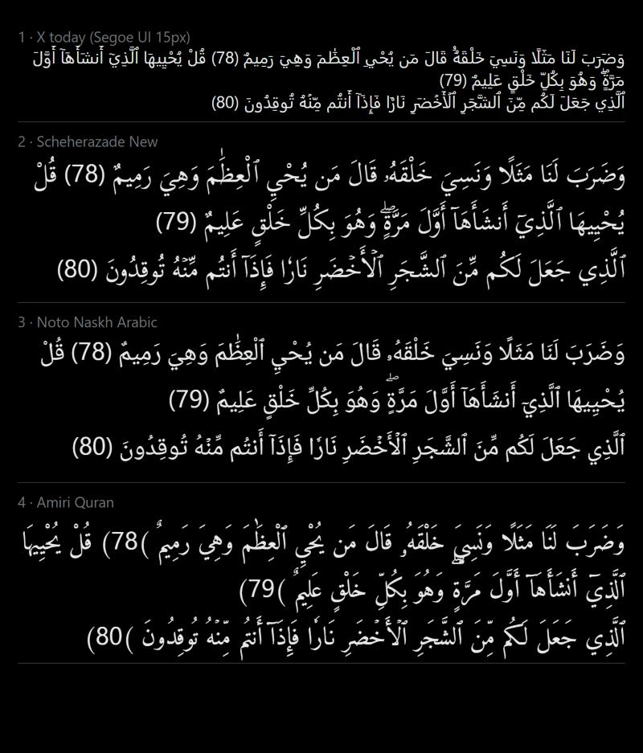

# X Quran Font

A userscript that makes Quran verses on X (Twitter) readable. Posts containing Quran text are shown in a Naskh font (Scheherazade New), 1.5× larger and with taller lines, so the diacritics no longer collide. Other posts are left untouched.



## Why X shows verses badly

- X has no Arabic font, so Arabic falls back to Segoe UI on Windows. That UI font mangles Uthmani marks such as the small waw (ۥ), the Quranic sukun (ۡ), open tanween (ٗ) and pause marks (ۖ).
- Post text is 15px with 20px lines, so stacked diacritics crowd the line above.
- Installing a better font does not help in Brave: Shields hides user-installed fonts from x.com.

## Install

Requires Violentmonkey (or Tampermonkey) in a Chromium browser.

1. Open **[x-quran-font.user.js (raw)](https://raw.githubusercontent.com/roko-tech/x-quran-font/main/x-quran-font.user.js)**.
2. Click **Install** on the userscript manager's page.
3. Reload x.com.

The manager downloads the font (about 80 KB) once, at install time. Updates arrive automatically from this repository's `main` branch.

Details, settings and troubleshooting: [user guide](docs/user/README.md).

## Development

No dependencies. You need Node.js 22 or later and Python 3.12 or later.

```shell
node --check x-quran-font.user.js
node --test tests/x-quran-font.test.cjs
python scripts/verify.py
python -m unittest discover -s tests -v
git diff --check
```

Changes: bump `@version`, add a [changelog](CHANGELOG.md) entry, and repeat the manual check on x.com in [docs/testing.md](docs/testing.md).

## Docs

- [Product brief](docs/product/brief.md) and [architecture](docs/architecture/overview.md)
- [ADR-0002: load the font from its bytes](docs/architecture/decisions/0002-load-the-font-from-its-bytes.md)
- [Testing](docs/testing.md) and [threat model](docs/security/threat-model.md)
- Full map: [docs/README.md](docs/README.md)

## License

[MIT](LICENSE). The font is not stored in this repository: Scheherazade New (SIL Open Font License) is fetched from jsDelivr when the script is installed.
