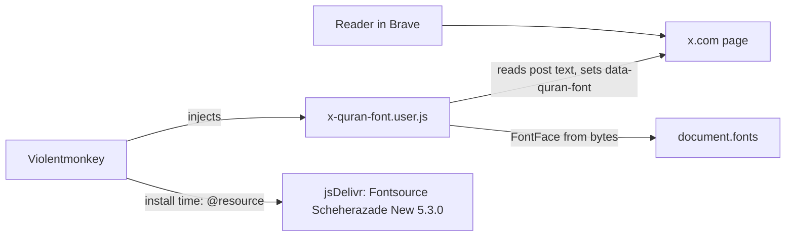

# Architecture overview

- Status: Current (v1.0.1)
- Owner: @rokogan
- Last reviewed: 2026-11-19

## Shape

One file, [`x-quran-font.user.js`](../../x-quran-font.user.js), run by a userscript manager on x.com and twitter.com at `document-start`. There is no server, no build, no stored state and no runtime dependency. [ADR-0001](decisions/0001-default-to-a-modular-monolith.md) applies only trivially: there is one module.

## Flow

1. **Font.** `GM_getResourceURL('quranFont', false)` returns the font the manager cached at install, as a `data:` URL. The script decodes it to bytes and adds `new FontFace('X Quran Font', bytes)` to `document.fonts`. No URL is fetched, so X's CSP does not apply. See [ADR-0002](decisions/0002-load-the-font-from-its-bytes.md).
2. **Style.** One `<style>` rule targets `[data-testid="tweetText"][data-quran-font]` and sets the font, `1.5rem` size and `1.9` line height. Descendant spans inherit them.
3. **Detection.** A `MutationObserver` on the whole document (child lists and text) queues at most one scan per animation frame. Each scan re-tests every post text and toggles `data-quran-font`. Re-testing on every scan keeps the mark right when X re-renders or swaps text.

State lives in a `data-*` attribute because X rewrites `class` on re-render.

## External contracts the script relies on

| Contract | Owner | If it changes |
| --- | --- | --- |
| `data-testid="tweetText"` on post text | X | Nothing matches; X's normal look returns |
| Root font size equals X's base text size | X | Size scales differently; adjust `FONT_SIZE` |
| `GM_getResourceURL(name, false)` returns a `data:` URL | Violentmonkey and Tampermonkey | Font decoding fails; posts still enlarge |
| Pinned Fontsource 5.3.0 file on jsDelivr | jsDelivr/npm (immutable versions) | Install fails to fetch the font |

## Data

The script reads post text in the page and writes only the `data-quran-font` attribute and one style element. It stores and sends nothing. See the [threat model](../security/threat-model.md).

Decisions are indexed in [decisions/README.md](decisions/README.md).
