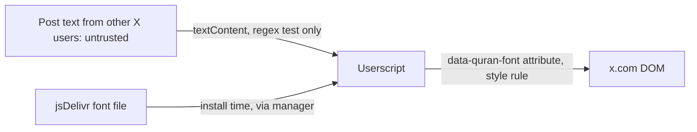

# Threat model

- Status: Current (v1.0.1)
- Owner: @rokogan
- Last reviewed: 2026-11-19

## Scope and objectives

The userscript runs inside the user's logged-in x.com session with access to everything on the page. It must:

- never send page content or account data anywhere;
- never execute or interpret post text, only test it against fixed regular expressions;
- load only the pinned font file, through the userscript manager.

## Assets

| Asset | Sensitivity | Where |
| --- | --- | --- |
| The user's X session and page content | High | Browser; the script reads post text only |
| The installed script | High: it runs on a logged-in site | Userscript manager storage |
| Source | Low: private repository | GitHub |

There are no credentials, stored data, logs or telemetry.

## Trust boundaries

## Threat register

| Scenario | Path | Impact | Control | Residual risk |
| --- | --- | --- | --- | --- |
| Malicious post text | Crafted text in a post | Script misbehaves or injects markup | Text is only read via `textContent` and matched by bounded character-class regexes; nothing is written back except an attribute | Low |
| Tampered font file | Compromised CDN or package | Malformed font reaches the browser's font parser | Exact version pin (`@fontsource/scheherazade-new@5.3.0`); fetched once at install; browsers sanitize web fonts | Low; accepted |
| Tampered script update | Someone edits the repository, or the manager fetches an "update" from where the script was installed | Arbitrary code on a logged-in x.com | Private repository; no `@updateURL`. Violentmonkey may still check the URL it installed from, so install by dragging the file in, or untick **Allow update** in the script's settings | Low |
| Data exfiltration | A future edit adds network calls | Account or post data leaks | The script has no network calls, and only `GM_getResourceURL` is granted. Review rule in [AGENTS.md](../../AGENTS.md) | Low |
| Performance abuse | A huge page or flood of mutations | Page jank | At most one scan per animation frame; linear regex tests | Low |
| Dependency or CI compromise | Mutable action | Bad CI result | Actions pinned to full SHAs; read-only token | Low |

## Review triggers

Revisit when adding a `@grant`, network access, storage, a new `@match` site, an `@updateURL`, or a new font source.
