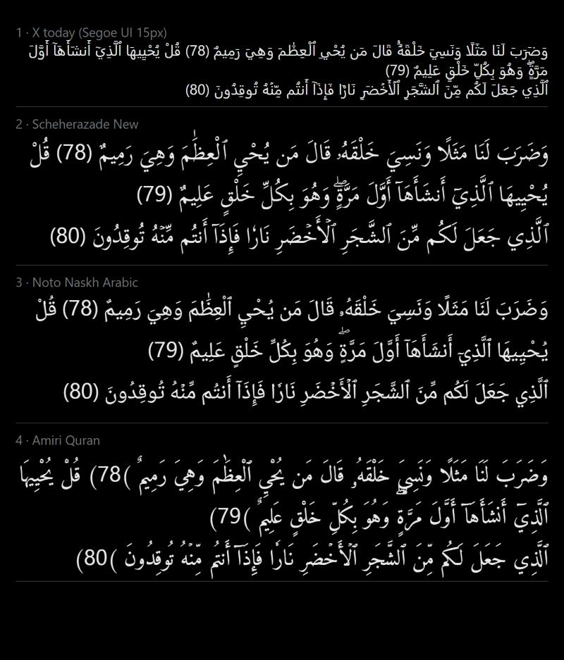

# User guide

## Install

1. Install [Violentmonkey](https://violentmonkey.github.io/) (or Tampermonkey) in Brave or Chrome.
2. Open `x-quran-font.user.js` in the browser: drag the file into a tab, or serve this folder locally (for example `python -m http.server 8000 --bind 127.0.0.1`) and open `http://127.0.0.1:8000/x-quran-font.user.js`.
3. Click **Install**. The manager downloads the font once, about 80 KB, from jsDelivr.
4. Reload x.com. Posts with Quran verses now appear larger, in Scheherazade New.

Update: open the new file the same way and click **Reinstall**. Because the repository is private, automatic updates are not set up.

## Which posts change

A post is restyled when its text contains either:

- Uthmani script: alef wasla (ٱ) or a Quranic annotation mark such as ۖ ۗ ۚ ۡ ۥ ۦ; or
- full vocalisation in ordinary spelling: at least 20 harakat, and at least one haraka for every two Arabic letters.

Everything else, including Arabic with only a few harakat, keeps X's normal look.

1 = X's default, 2 = Scheherazade New (used), 3 = Noto Naskh Arabic, 4 = Amiri Quran (its verse-number brackets break).

## Settings

Edit the script in Violentmonkey, then save:

| Change | Where |
| --- | --- |
| Text size | `FONT_SIZE`, default `1.5rem` (X's own size is `1rem`) |
| Line spacing | `LINE_HEIGHT`, default `1.9` |
| Font | the `@resource quranFont` URL. Noto Naskh Arabic: `https://cdn.jsdelivr.net/npm/@fontsource/noto-naskh-arabic@5.3.0/files/noto-naskh-arabic-arabic-400-normal.woff2` |

After changing `@resource`, reinstall the script so the manager downloads the new font.

## Troubleshooting

| Symptom | Likely cause | Fix |
| --- | --- | --- |
| Verses are bigger but still look like the old font | The font did not load | Reinstall the script so the manager downloads the font again. In the console, `[...document.fonts].map(f => f.family + ':' + f.status)` should include `X Quran Font:loaded`. |
| A Quran post is not restyled | It has no Uthmani marks and fewer than 20 harakat, such as a short verse in ordinary spelling | Known limitation; see below. |
| An ordinary post is restyled | It is fully vocalised (poetry, a du'a) | Expected: the detection treats any fully vocalised text as verse-like. |

## Privacy

The script reads post text only in your browser and sends nothing anywhere. The only network request is the userscript manager downloading the font from jsDelivr at install time.

## Known limitations

- Short verses typed in ordinary spelling with fewer than 20 harakat are not detected.
- Translated posts, the post composer and direct messages are not restyled; only post text (`data-testid="tweetText"`) is.
- Verse numbers and Latin text use X's normal font, because the bundled font covers Arabic only.
- Tested in Brave with Violentmonkey on Windows. Other browsers and managers have not been tested.
